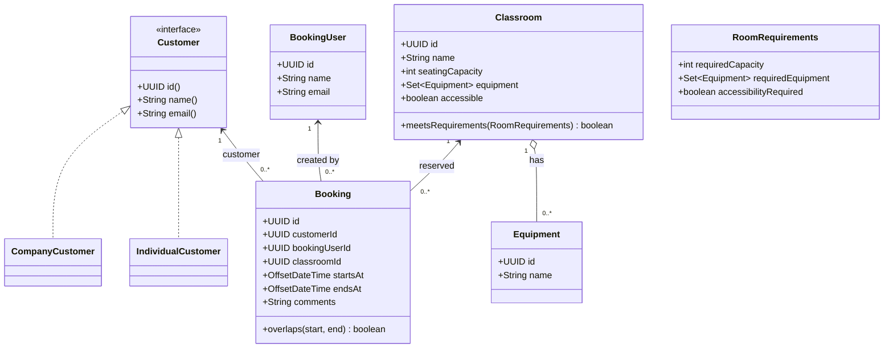

# Classroom Booking System

A Java 25 console application for managing classroom availability and bookings for a facility with 20 training rooms. Customers may be companies or individuals. The system is designed to validate classroom capacity, equipment, accessibility, and booking conflicts, and persist data in PostgreSQL through JDBC.

> The repository is being developed one feature at a time. The PostgreSQL/JDBC foundation and customer registration are implemented. Classroom management, room search, booking creation, and booking schedule views remain in the implementation plan.

## Requirements and design

- [Project scenario and functional requirements](PROJECT_SCENARIO.md)
- [Project requirements and submission checklist](PROJECT_REQUIREMENTS.md)
- [UML class diagram and domain design](docs/uml-design.md)
- [MVC architecture and relational database model](docs/architecture.md)
- [Feature-by-feature implementation plan](docs/implementation-plan.md)

## Technology

- Java 25 and Maven
- PostgreSQL 17
- JDBC PostgreSQL driver
- Docker Compose for the local database
- JUnit 5 and JaCoCo for testing and line-coverage enforcement

## Run locally (WSL)

1. Copy `.env.example` to `.env` and set a non-empty `POSTGRES_PASSWORD`.
2. Start PostgreSQL:

   ```bash
   docker compose up -d database
   ```

3. Export the `.env` settings into the shell and initialize/check the database:

   ```bash
   set -a && source .env && set +a
   mvn compile exec:java
   ```

The local PostgreSQL port is `5433`. On startup, the application initializes the schema and applies idempotent seed data. The 20 seeded room attributes are demonstration values; replace them with the facility's verified inventory when available.

Stop PostgreSQL with:

```bash
docker compose down
```

## Tests and coverage

With PostgreSQL running and `.env` loaded in the shell, run unit and integration tests:

```bash
set -a && source .env && set +a
mvn -Ddb.integration=true verify
```

The Maven build enforces a minimum of 90% line coverage. JaCoCo writes its report to `target/site/jacoco/index.html`. Integration tests exercise the console customer-registration flow against PostgreSQL and check repeatable schema initialization, seeded classroom/equipment relationships, email uniqueness, and booking-overlap constraints.

## UML class diagram



The detailed diagram, including services, repository abstractions, and the console booking flow, is in [docs/uml-design.md](docs/uml-design.md).

## Git workflow

Implement one feature at a time on a short-lived branch from `main`. Keep commits small and focused, with messages that explain the change. After review and verification, merge the completed feature branch back into `main`. See the [implementation plan](docs/implementation-plan.md) for the planned feature sequence.
