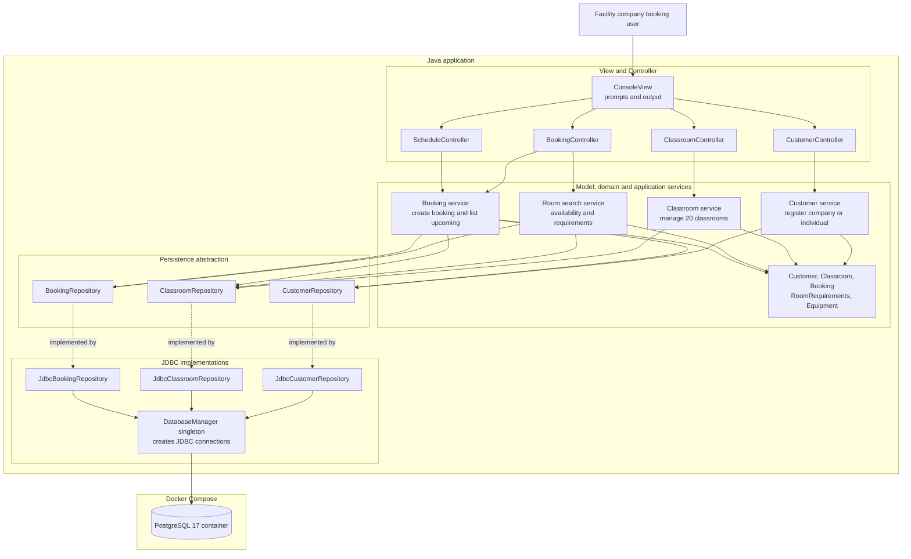
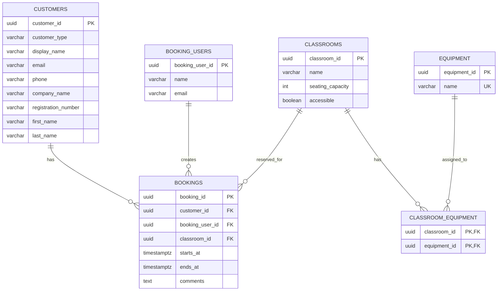

# Classroom Booking System Architecture

The application is a console-based Java program using MVC at the presentation boundary, with a small DDD-inspired domain model. Application services coordinate use cases, repository interfaces abstract persistence, JDBC repository classes execute SQL, and a relational database stores customers, booking users, classrooms, equipment, and bookings.

## Runtime architecture



### MVC responsibilities

- **View — `ConsoleView`:** displays the menu, prompts for input, formats search results and bookings, and reports validation errors. It contains no booking or SQL rules.
- **Controllers — customer, classroom, booking, and schedule controllers:** translate console input into service calls, select the relevant use case, and pass results/errors back to the view. Controllers do not contain SQL or domain rules.
- **Model — domain objects and application services:** stores customer/classroom/booking state and enforces booking/search rules. Services coordinate repository calls; JDBC repositories implement persistence.

### Design principles

- **DDD (lightweight):** keep the problem model focused on `Customer`, `Classroom`, `Booking`, `RoomRequirements`, and `Equipment`. Treat `Booking`, `Customer`, and `Classroom` as aggregate roots, and have services coordinate invariants that require checking existing bookings. Keep repository interfaces near the model boundary; JDBC details stay in infrastructure.
- **SOLID:** **Single responsibility** keeps console controllers, application services, domain objects, and JDBC repositories focused. **Open/closed** keeps customer-specific behavior behind the `Customer` abstraction instead of spreading type checks across services. **Liskov substitution** requires both customer subtypes to work wherever a `Customer` is expected. **Interface segregation** keeps customer, classroom, and booking persistence contracts separate. **Dependency inversion** makes services depend on repository interfaces, with JDBC implementations supplied at startup.
- **KISS:** use a small console MVC, a few domain/services/repositories, and only the tables required by the supplied scope. Avoid adding authentication, web controllers, recurring bookings, cancellation workflows, or other unrequested features.
- **Singleton:** use one `DatabaseManager` instance as the JDBC connection factory/configuration holder. It creates a fresh `Connection` per unit of work; never share a live JDBC `Connection` as a singleton. Obtain it once during application startup and pass it into JDBC repositories.

### Request flow

1. `ConsoleView` gathers the requested date/time range, capacity, equipment, accessibility needs, customer, booking user, and optional comments.
2. A controller translates the input to a request and calls `RoomSearchService`, which checks classroom attributes and existing bookings.
3. The controller presents matching rooms. When a room is selected, it calls `BookingService` to validate again and save the booking.
4. JDBC repositories use parameterized SQL and a transaction for the conflict check and booking insert. Results return through the controller to the console view.

## Relational data model



`CLASSROOM_EQUIPMENT` represents the many-to-many relationship between rooms and equipment. A booking references exactly one customer, one booking user, and one classroom. Equipment and accessibility requirements are matched against classroom data when searching and validating the booking. The classroom table is not constrained to exactly 20 rows so the inventory can be managed. `src/main/resources/db/seed.sql` currently contains clearly labeled demonstration room attributes because the facility's verified inventory was not included in the requirements; replace them when the actual inventory is provided.

The application uses PostgreSQL through the PostgreSQL JDBC driver. Docker Compose runs the database and stores its data in the named `classroom-booking-data` volume. Copy `.env.example` to `.env` to customize local connection settings, then start/stop the database with `docker compose up -d database` and `docker compose down`.

From the Java application running on the host, the default JDBC URL is `jdbc:postgresql://localhost:5433/classroom_booking`. `DatabaseManager` reads `POSTGRES_HOST`, `POSTGRES_PORT`, `POSTGRES_DB`, `POSTGRES_USER`, and `POSTGRES_PASSWORD` from the process environment; `JDBC_URL` can override the generated URL. In WSL, load local settings with `set -a && source .env && set +a` before running Maven. The database service is health-checked before use.

To initialize the schema and run the console readiness check from WSL:

```bash
docker compose up -d database
set -a && source .env && set +a
mvn compile exec:java
```

Run the PostgreSQL integration check with `mvn -Ddb.integration=true verify` while the database is running.
That verification also enforces at least 90% line coverage and writes the report to `target/site/jacoco/index.html`.
