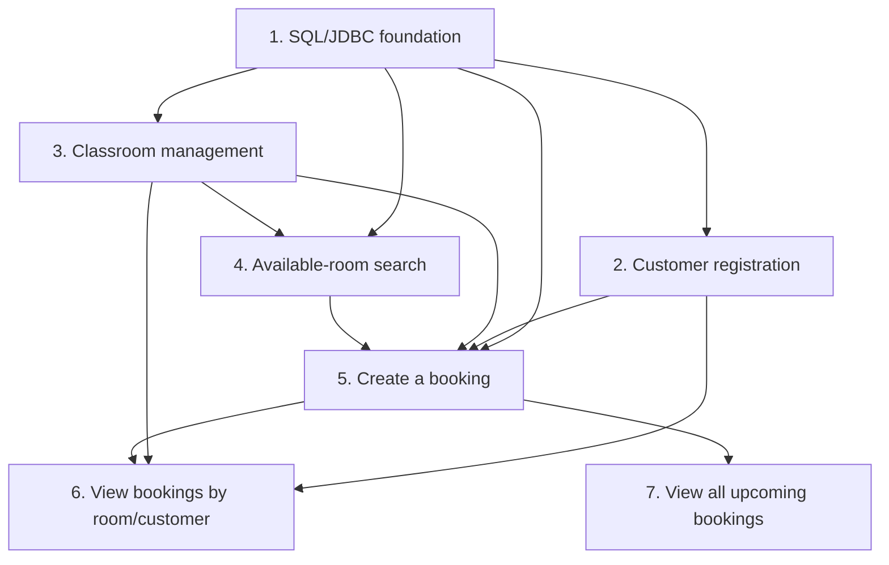

# Feature-by-Feature Implementation Plan

Implement and integrate one feature at a time. Each feature should have its own short-lived Git branch, focused commits, acceptance checks, and merge back into `main` before starting the next feature. For each feature, identify its **Model**, **View**, and **Controller** work as below. Follow the lightweight DDD, SOLID, KISS, and limited Singleton guidance in [architecture.md](architecture.md).

## Before implementation

- Use PostgreSQL as the relational database, the PostgreSQL JDBC driver in Maven, and Docker Compose for the local database service.
- Copy `.env.example` to `.env` when local connection settings need customization; `.env` is ignored by Git.
- Agree on the equipment values used by the facility (for example, projector and whiteboard).
- Add meaningful automated tests as each feature is implemented; use JDBC integration tests for database behavior and keep line coverage at or above 90%.
- Keep the View responsible for console input/output, the Controller responsible for coordinating a user action, and the Model responsible for domain rules and persistence-facing use cases.

## Feature dependencies

The arrows below indicate prerequisite features, not the order teams must work in. For example, customer registration and classroom management can proceed independently once the SQL/JDBC foundation is ready.

| Feature | Prerequisites | Why |
| --- | --- | --- |
| 1. SQL/JDBC foundation | None | Provides PostgreSQL schema, connection management, and seed data. |
| 2. Customer registration | 1 | Customers need durable SQL/JDBC persistence. |
| 3. Classroom management | 1 | Classroom and equipment inventory is stored in PostgreSQL. |
| 4. Available-room search | 1, 3 | Search filters classroom attributes and existing booking rows. Use test fixtures for overlapping bookings until booking creation is implemented. |
| 5. Create a booking | 1, 2, 3, 4 | A booking references a registered customer and booking user, reserves a managed classroom, and rechecks availability. |
| 6. View bookings by room/customer | 1, 2, 3, 5 | These queries need saved bookings and their classroom/customer associations. |
| 7. View all upcoming bookings | 1, 5 | This view needs booking rows to query and sort. |

## Feature sequence

### 1. SQL/JDBC foundation — implemented

**Branch:** `feature/database-foundation`

- Add environment-based PostgreSQL configuration and JDBC connection management.
- Add `docker-compose.yml` for the PostgreSQL service and persistent named volume.
- Implement `DatabaseManager` as the single JDBC connection factory, returning a fresh connection per operation/transaction; pass it to JDBC repositories at startup.
- Create idempotent schema initialization for customers, booking users, classrooms, equipment, classroom-equipment links, and bookings with primary keys, foreign keys, checks, and room/time overlap protection.
- Seed 20 demonstration classrooms with varied capacity/equipment/accessibility; replace these placeholders with verified facility data when supplied.

**Model:** define customer, booking user, classroom, equipment, room requirements, and booking records plus focused repository interfaces and a connection-factory abstraction.

**Controller:** wire the database initializer and connection factory during application startup; do not put SQL logic in controllers.

**View:** add a minimal console startup/error message for database readiness.

**Done when:** schema initialization can be run repeatedly without duplicating seed data; an integration check can connect and read all 20 seeded classrooms and their room-equipment relationships; JDBC resources are closed correctly.

### 2. Customer registration — implemented

**Branch:** `feature/customer-registration`

- Implement the `Customer` abstraction and company/individual customer types.
- Add customer repository CRUD operations and service validation.

**Model:** `Customer`, `CompanyCustomer`, `IndividualCustomer`, `CustomerService`, and `CustomerRepository` operations.

**Controller:** handle register/list customer actions and call `CustomerService`.

**View:** prompt for company/individual details and display saved customers or validation errors.

**Done when:** both customer types can be registered, saved through JDBC, loaded again, and displayed correctly. This feature is implemented and covered by console and JDBC integration tests.

### 3. Classroom management

**Branch:** `feature/classroom-management`

- Implement classroom and equipment domain types.
- Implement classroom and equipment persistence, including the classroom-equipment relationship.

**Model:** `Classroom`, `Equipment`, `ClassroomService`, and classroom/equipment repository operations.

**Controller:** handle list/create/update/delete actions and coordinate service calls.

**View:** prompt for classroom name, seating capacity, equipment, and accessibility; display inventory/results.

**Done when:** classroom data and equipment survive a database reload, and the console can manage the 20-room inventory.

### 4. Available-room search — implemented

**Branch:** `feature/available-room-search`

- Accept a date/time range, required capacity, equipment set, and accessibility requirement.
- Filter out classrooms with an overlapping booking.
- Use collections and streams for the required filtering and sorting.

**Model:** `RoomRequirements` and `RoomSearchService`; use classroom and booking repositories to gather candidates and conflicts.

**Controller:** validate the search input shape and invoke the room search use case.

**View:** prompt for date/time, capacity, equipment, and accessibility; show matching classrooms or an empty result.

**Done when:** tests cover each filter and confirm that overlapping bookings make a room unavailable while non-overlapping times remain available. This feature is implemented through the console and JDBC repositories and covered by unit and PostgreSQL integration tests.

### 5. Create a booking

**Branch:** `feature/create-booking`

- Implement the booking model and request with customer, booking user, selected classroom, date/time range, requirements, and optional comments.
- Validate the selected classroom against capacity, equipment, and accessibility requirements.
- Check for room conflicts and insert the booking using a JDBC transaction so the room cannot be double-booked.

**Model:** `Booking`, `BookingRequest`, `BookingService`, and repository operations; enforce booking invariants and transactionally check conflicts.

**Controller:** coordinate search/selection, customer lookup, and booking creation using service interfaces.

**View:** collect the booking user, customer, room, date/time, requirements, and optional comments; display confirmation or a clear reason for rejection.

**Done when:** a valid booking is persisted and linked to its customer, booking user, and classroom; invalid requirements and conflicting bookings are rejected; comments may be omitted.

### 6. View bookings by room and customer

**Branch:** `feature/bookings-by-room-customer`

- Add repository queries and sort results by start time.

**Model:** booking query methods for a selected classroom or customer; return upcoming booking data.

**Controller:** handle the room/customer selection and call the appropriate query operation.

**View:** prompt for the room or customer and display its upcoming bookings in time order.

**Done when:** each view returns only bookings linked to the selected room or customer and displays them in time order.

### 7. View all upcoming bookings

**Branch:** `feature/upcoming-bookings`

- Add a query/service operation for all upcoming bookings, filtered and sorted by start time.

**Model:** provide the all-upcoming-bookings query and ordered results.

**Controller:** invoke the schedule query when the user selects this action.

**View:** add the menu option and display all upcoming bookings chronologically.

**Done when:** the list includes upcoming bookings across all rooms and is sorted chronologically.

## Per-feature workflow

1. Create a feature branch from the current `main`.
2. Implement only that feature and add its relevant tests.
3. Run the feature's tests and `mvn verify`.
4. Review the diff, make a focused commit with a clear message, and merge the feature branch into `main`.
5. Confirm `main` builds before starting the next feature.

Keep commits small and explanatory (for example, `Add JDBC classroom repository`). Avoid mixing unrelated features into the same branch or commit.
