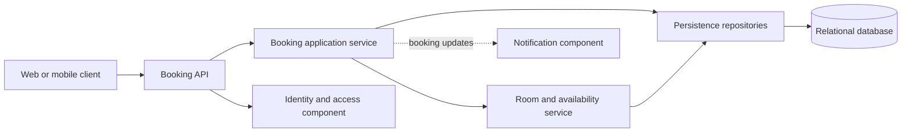
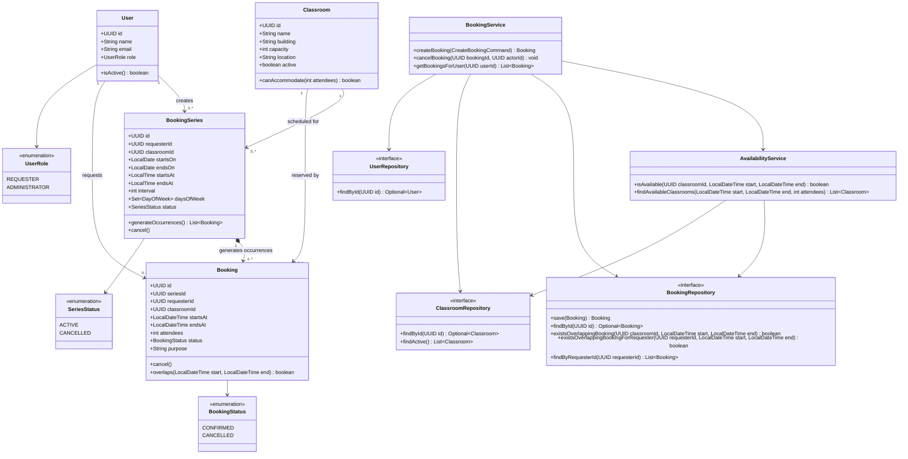
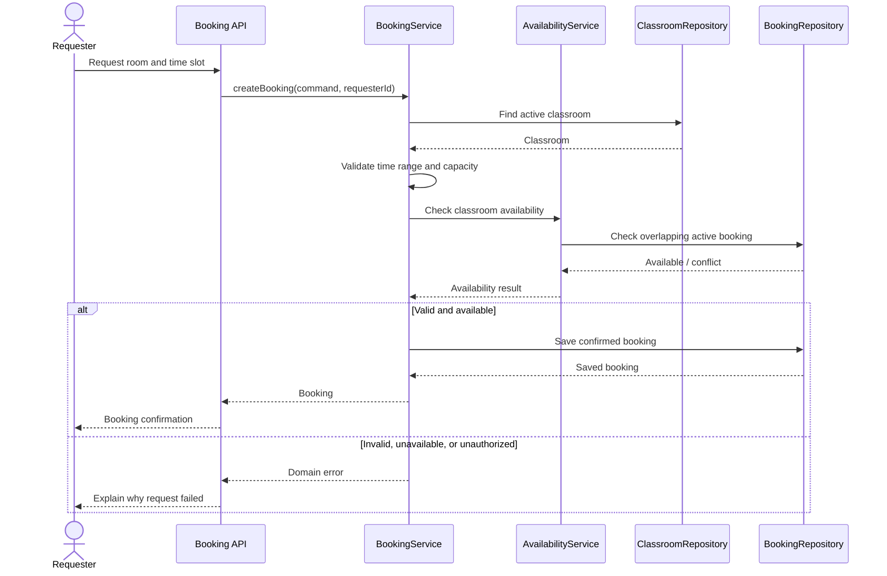

# Classroom Booking System — Initial UML Design

This is a first-pass domain and component model to guide implementation. Users book a classroom for a date and time; a booking is confirmed immediately if it does not overlap another active booking for the same room. There is no approval workflow.

## Initial scope

Keep the first version focused on users, classrooms, one-time bookings, and recurring bookings. Equipment requests and setup/cleanup buffers are out of scope. Start recurring bookings with a simple weekly schedule over a defined date range; defer advanced recurrence rules and per-occurrence edits.

## System components

| Component | Responsibility |
| --- | --- |
| Web or mobile client | Lets users find rooms, view availability, and create or manage bookings. |
| Booking API | Validates requests at the system boundary and exposes booking and room operations. |
| Identity and access | Identifies users and applies role-based permissions (for example, requester and administrator). |
| Booking application service | Coordinates booking creation, cancellation, and status changes. |
| Room and availability service | Finds rooms and checks whether a requested time interval is available. |
| Persistence repositories | Load and store users, rooms, and bookings without exposing database details to the domain. |
| Notification component | Sends booking confirmations or status updates; it can be integrated after the core booking flow. |

## Core class diagram

## Booking creation flow

## Initial business rules

1. A booking is confirmed immediately when created successfully; administrator approval is not required.
2. A booking can be made no more than 7 days before it starts.
3. A booking must have a start time before its end time.
4. The classroom must be active and have capacity for the requested attendee count.
5. A room cannot have overlapping bookings that are not cancelled. Adjacent intervals are allowed (for example, 10:00–11:00 and 11:00–12:00).
6. A requester cannot have overlapping active bookings, even when the bookings are for different rooms. Adjacent bookings are allowed.
7. A recurring booking creates individual booking occurrences according to its recurrence pattern. Each occurrence becomes a confirmed booking when it enters the 7-day booking window and passes room availability, capacity, and requester conflict checks.
8. Cancellation is an optional action: a requester may cancel their own booking, and administrators may manage any booking. No 24-hour cancellation cutoff is specified.
9. Room availability, requester availability, and booking creation must be checked transactionally, or protected by a database constraint/locking strategy, to avoid conflicting simultaneous requests.

## Open decisions

- Should recurring bookings later support additional patterns (for example, monthly schedules), excluded dates, or editing a single occurrence?
- Which identity provider and user roles should be supported?
- What are the timezone and opening-hours policies?
- Should notifications be email, in-app, or both?
