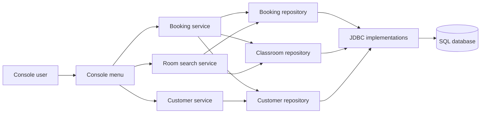
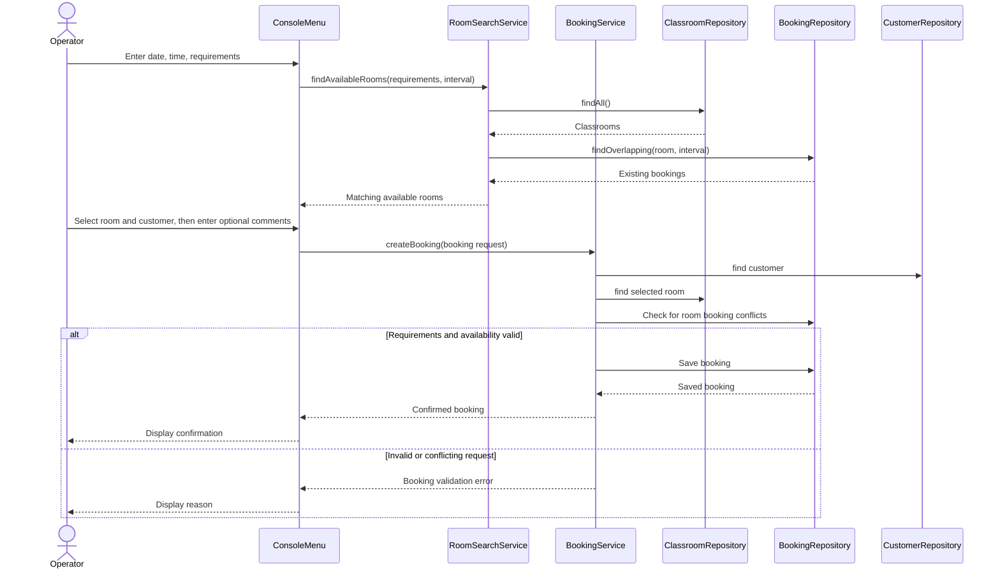

# Classroom Booking System — Requirements and UML Design

This design reflects only the supplied facility-management requirements: manage 20 training classrooms, register company and individual customers, search and book rooms through a console, and persist data in a SQL database using JDBC.

## Scope

The system manages the facility's 20 classrooms, external company and individual customers, booking users, and room bookings. It supports searching for available classrooms using date/time, capacity, equipment, and accessibility requirements. It has a console menu and SQL/JDBC persistence. Optional comments are stored on bookings. No other booking policies or features are assumed.

## System components

| Component | Responsibility |
| --- | --- |
| Console menu | Reads commands and input, invokes application services, and displays results. |
| Booking service | Validates booking rules, links the customer and booking user, and coordinates persistence. |
| Room search service | Filters the 20 managed classrooms by time, capacity, equipment, accessibility, and booking conflicts. |
| Customer service | Registers and retrieves company or individual customers. |
| Repository interfaces | Abstract SQL persistence so application and domain code do not depend on JDBC details. |
| JDBC repositories | Implement repository operations using JDBC and parameterized SQL. |
| SQL database | Stores customers, booking users, classrooms, equipment, and bookings. |

## Core class diagram

```mermaid
classDiagram
    class Customer {
        <<abstract>>
        -UUID id
        -String contactName
        -String email
        -String phone
        +getDisplayName() String
    }

    class CompanyCustomer {
        -String companyName
        -String registrationNumber
        +getDisplayName() String
    }

    class IndividualCustomer {
        -String firstName
        -String lastName
        +getDisplayName() String
    }

    class BookingUser {
        -UUID id
        -String name
        -String email
        +getId() UUID
    }

    class Classroom {
        -UUID id
        -String name
        -int seatingCapacity
        -Set~Equipment~ equipment
        -boolean accessible
        +meetsRequirements(RoomRequirements) boolean
    }

    class Equipment {
        <<enumeration>>
        PROJECTOR
        WHITEBOARD
        VIDEO_CONFERENCING
        COMPUTER
    }

    class RoomRequirements {
        +int requiredCapacity
        +Set~Equipment~ requiredEquipment
        +boolean accessibilityRequired
    }

    class Booking {
        -UUID id
        -LocalDateTime startsAt
        -LocalDateTime endsAt
        -String comments
        +overlaps(LocalDateTime start, LocalDateTime end) boolean
    }

    class BookingRequest {
        +UUID customerId
        +UUID bookingUserId
        +UUID classroomId
        +LocalDateTime startsAt
        +LocalDateTime endsAt
        +RoomRequirements requirements
        +String comments
    }

    class ConsoleMenu {
        +run() void
        -registerCustomer() void
        -manageClassrooms() void
        -createBooking() void
        -searchAvailableRooms() void
        -showUpcomingBookings() void
    }

    class BookingService {
        +createBooking(BookingRequest) Booking
        +findUpcomingByRoom(UUID classroomId) List~Booking~
        +findUpcomingByCustomer(UUID customerId) List~Booking~
        +findAllUpcoming() List~Booking~
    }

    class RoomSearchService {
        +findAvailableRooms(RoomRequirements, LocalDateTime, LocalDateTime) List~Classroom~
    }

    class CustomerService {
        +registerCustomer(Customer) Customer
    }

    class CustomerRepository {
        <<interface>>
        +save(Customer) Customer
        +findById(UUID) Optional~Customer~
        +findAll() List~Customer~
        +update(Customer) void
        +deleteById(UUID) void
    }

    class ClassroomRepository {
        <<interface>>
        +save(Classroom) Classroom
        +findAll() List~Classroom~
        +update(Classroom) void
        +deleteById(UUID) void
    }

    class BookingRepository {
        <<interface>>
        +save(Booking) Booking
        +findUpcoming() List~Booking~
        +findUpcomingByRoom(UUID classroomId) List~Booking~
        +findOverlapping(UUID classroomId, LocalDateTime start, LocalDateTime end) List~Booking~
        +findByCustomer(UUID customerId) List~Booking~
        +update(Booking) void
    }

    class JdbcCustomerRepository
    class JdbcClassroomRepository
    class JdbcBookingRepository

    Customer <|-- CompanyCustomer
    Customer <|-- IndividualCustomer
    Classroom o-- Equipment
    RoomRequirements o-- Equipment
    Customer "1" <-- "0..*" Booking : customer
    BookingUser "1" <-- "0..*" Booking : created by
    Classroom "1" <-- "0..*" Booking : reserves
    ConsoleMenu --> BookingService
    ConsoleMenu --> RoomSearchService
    ConsoleMenu --> CustomerService
    BookingService --> BookingRequest
    BookingService --> BookingRepository
    BookingService --> CustomerRepository
    BookingService --> ClassroomRepository
    RoomSearchService --> ClassroomRepository
    RoomSearchService --> BookingRepository
    JdbcCustomerRepository ..|> CustomerRepository
    JdbcClassroomRepository ..|> ClassroomRepository
    JdbcBookingRepository ..|> BookingRepository
```

`CompanyCustomer` and `IndividualCustomer` specialize the abstract `Customer` type and implement `getDisplayName()` polymorphically. Entity fields are private and exposed through validated constructors and accessors. Repository interfaces provide abstraction over JDBC implementations.

## Console booking flow

## SQL and JDBC design

Use normalized tables: `customers` (with a customer type and type-specific fields), `booking_users`, `classrooms`, `classroom_equipment`, and `bookings`. Seed the database with the facility's 20 classrooms and allow them to be managed through the classroom repository. Store booking references as foreign keys to customer, booking user, and classroom. Store optional comments as nullable text. A booking's capacity, equipment, and accessibility requirements are used to select and validate a suitable classroom; the booked room itself has its own equipment and accessibility attributes.

Repository interfaces isolate SQL operations from services. `JdbcCustomerRepository`, `JdbcClassroomRepository`, and `JdbcBookingRepository` own JDBC connections/statements and map rows to domain objects. Use prepared statements, try-with-resources, transactions when checking availability and saving, and translate `SQLException` into an application-level persistence exception. SQL constraints and transactions should help protect against overlapping bookings.

Repository methods cover insert (`save`), update (`update`), delete where appropriate (`deleteById` for customers/classrooms), and retrieval (`findById`, `findAll`, and booking queries).

## Console menu and collections

The console menu provides options to register a company or individual customer, manage classrooms, search rooms, create a booking, list upcoming bookings by room/customer, and list all upcoming bookings. Keep parsing and display in the console layer; booking and search rules belong in services/domain classes.

Room search can load candidate classrooms and use streams to filter by `seatingCapacity >= requiredCapacity`, equipment inclusion, accessibility, and absence of an overlapping booking. Upcoming-booking views filter future bookings and sort by start time. Use collections such as `Set<Equipment>` for room equipment and `List<Booking>` for results; keep SQL-backed retrieval in repositories and use streams for in-memory domain filtering/sorting.

## Implementation quality

Use focused domain, service, repository, and console classes. Encapsulate mutable state behind constructors and methods; use the `Customer` abstraction with company/individual implementations for polymorphism; model booking-to-customer, booking-user, and classroom relationships explicitly. Validate input and business rules with meaningful domain exceptions, and report recoverable input or persistence errors in the console without exposing SQL details. Add purpose-oriented class and method comments, especially around booking conflict checks.

## Business rules

1. A booking records its date/time range, customer, booking user, and selected classroom; comments are optional. Required capacity and equipment are supplied as booking criteria.
2. The selected classroom must meet the required capacity, equipment, and accessibility criteria.
3. A classroom cannot be double-booked during overlapping time ranges.
4. A booking is linked to exactly one customer, one booking user who created it, and one classroom.
5. Available-room search considers the requested time range and classroom capacity, equipment, and accessibility.
6. Upcoming booking lists are available for a classroom, a customer, and the whole system, ordered by scheduled time.
7. Availability checking and booking persistence must be transactionally protected to avoid conflicting simultaneous requests for the same room.
8. Optional comments are stored with the booking and are not required to create one.

## Open decisions

- Which SQL database and JDBC driver should be used?
